<p align="center">
  
</p>

<p align="center">
  <a href="https://www.anypayx.com"></a>
  <a href="https://www.npmjs.com/package/@anypay/walletbot"></a>
  <a href="https://heroku.com/deploy?template=https://github.com/anypay/walletbot-heroku"></a>
</p>

<p align="center">
  <a href="https://www.anypayx.com">Website</a> ·
  <a href="https://www.anypayx.com/docs">Docs</a> ·
  <a href="https://api.anypayx.com/api">API</a> ·
  <a href="https://www.anypayx.com/walletbot">WalletBot</a> ·
  <a href="https://github.com/anypay">GitHub</a>
</p>

---

## What It Is &amp; Purpose

**walletbot-heroku** is a one-click Heroku deployment template for [Anypay WalletBot](https://www.anypayx.com/walletbot) — the self-custody headless wallet that automates cryptocurrency payouts for businesses accepting Bitcoin, Ethereum, and stablecoins (USDC, USDT, RLUSD, NUSD).

This repository provides the minimal infrastructure to deploy a WalletBot worker on Heroku's free or hobby tier. It connects to the Anypay platform API (`walletbot.anypayx.com`), monitors invoice webhooks, and automatically sends crypto payments from your self-custodied wallet when invoices are paid.

No complex server setup, no Docker orchestration, no DevOps overhead. Click deploy, paste your seed phrase and auth token, and your automated crypto treasury is live in under 90 seconds.

## Why Use It

**For merchants and developers who need automated crypto payouts without managing infrastructure:**

- **Instant infrastructure** — Deploy a persistent WalletBot worker with one Heroku button click. No server provisioning, no container registries, no CI/CD pipelines to configure.
- **Self-custody guarantee** — Your 12-word seed phrase never leaves your Heroku dyno. Anypay never holds your private keys or crypto balances.
- **Multi-chain support** — WalletBot automatically handles Bitcoin, Ethereum, XRPL, Solana, Bitcoin Cash, Dogecoin, Litecoin, Dash, Polygon, Avalanche, Binance, and Stellar transactions based on your invoice currency settings.
- **Zero-touch payouts** — When a customer pays an Anypay invoice, WalletBot automatically signs and broadcasts the settlement transaction from your wallet to your designated payout addresses.
- **Built-in monitoring** — Prometheus metrics endpoint (`/metrics`) exposes WalletBot health, transaction counts, and API latency for Datadog, Grafana, or Heroku's native monitoring.

**Who it's for:** Anypay merchants who want to run their own WalletBot instance instead of using Anypay's hosted WalletBot service. Ideal for businesses that require self-custody, need dedicated worker isolation, or want full control over their crypto treasury automation.

**Where it fits:** This template sits between your Anypay merchant dashboard (where you configure invoice webhooks and payout rules) and your self-custodied crypto wallet. It's the execution layer — the robot that listens for "invoice paid" events and sends the funds where you told it to go.

## How It Works

<p align="center">
  
</p>

1. **Heroku Dyno** — The `app.json` manifest defines a Heroku app with two required environment variables (`WALLETBOT_SEED_PHRASE` and `WALLETBOT_AUTH_TOKEN`). On first deploy, Heroku provisions a dyno, injects your secrets, runs `npm install`, compiles the TypeScript source (`npm run build`), and starts the worker (`node dist/main.js` via the `Procfile`).

2. **WalletBot Worker** — The `src/main.ts` entry point instantiates `@anypay/walletbot` with your credentials. WalletBot derives wallet keys from your seed phrase, connects to the Anypay API (`https://walletbot.anypayx.com`), and polls for pending payout tasks. The worker exposes a Prometheus metrics endpoint on the Heroku-assigned `PORT` for observability.

3. **Anypay API** — When a customer completes an invoice payment on-chain, the Anypay platform verifies the transaction and queues a payout task for your WalletBot. The API sends the payout instruction (recipient address, amount, currency, chain) to your worker's authenticated session.

4. **Crypto Payouts** — WalletBot receives the payout task, constructs and signs the blockchain transaction using your self-custodied wallet, broadcasts it to the appropriate network (Bitcoin, Ethereum, XRPL, etc.), and reports the transaction ID back to Anypay for invoice settlement confirmation.

The entire flow is event-driven and asynchronous. Your Heroku dyno runs 24/7 (or during your scheduled uptime window), processing payouts as they arrive with no manual intervention.

## Quickstart / How to Use It

### Prerequisites

Before deploying, you need:

1. **Anypay merchant account** — Sign up at [anypayx.com/auth/signup](https://www.anypayx.com/auth/signup) and complete merchant onboarding.
2. **WalletBot auth token** — Generate one from your Anypay dashboard under **Settings → WalletBot API Keys**.
3. **12-word BIP39 seed phrase** — Either use an existing wallet seed or generate a fresh one with a tool like [iancoleman.io/bip39](https://iancoleman.io/bip39) (for production, generate offline and store securely). **NEVER commit your seed phrase to version control or share it with anyone.**
4. **Heroku account** — Free tier works for testing; hobby or production dynos recommended for 24/7 uptime.

### Deploy to Heroku

Click the button below to launch the deployment wizard:

[](https://heroku.com/deploy?template=https://github.com/anypay/walletbot-heroku)

**During Heroku setup:**

1. **App Name** — Choose a unique Heroku app name (e.g., `my-walletbot-production`).
2. **Region** — Select US or EU based on your location.
3. **Config Vars:**
   - `WALLETBOT_SEED_PHRASE` — Paste your 12-word mnemonic (space-separated, no extra characters).
   - `WALLETBOT_AUTH_TOKEN` — Paste your WalletBot API key from the Anypay dashboard.
4. Click **Deploy app**. Heroku will:
   - Clone this repository
   - Run `npm install` and `npm run build`
   - Start the worker with `node dist/main.js`

**Verify deployment:**

```bash
# View real-time logs
heroku logs --tail --app YOUR_APP_NAME

# Check Prometheus metrics (requires Heroku CLI)
heroku open --app YOUR_APP_NAME
# Then navigate to: https://YOUR_APP_NAME.herokuapp.com/metrics
```

You should see WalletBot connect to the Anypay API and begin listening for payout tasks. The metrics endpoint exposes `walletbot_*` gauges and counters for monitoring.

### Local Development (Optional)

To run WalletBot locally for testing:

```bash
# Clone the repository
git clone https://github.com/anypay/walletbot-heroku.git
cd walletbot-heroku

# Install dependencies
npm install

# Create a .env file with your credentials
cat > .env << 'EOF'
WALLETBOT_SEED_PHRASE="your twelve word seed phrase goes here with spaces"
WALLETBOT_AUTH_TOKEN="your_walletbot_api_key_from_dashboard"
PORT=5000
EOF

# Build and start the worker
npm run build
npm start
```

**Never commit `.env` to version control.** The `.gitignore` already excludes it.

### Configuration

The WalletBot instance is configured in `src/main.ts`. Available options:

| Option | Default | Description |
| --- | --- | --- |
| `api_base` | `https://walletbot.anypayx.com` | Anypay WalletBot API endpoint |
| `websocket_enabled` | `false` | Use WebSocket for real-time updates (not needed on Heroku) |
| `http_api_enabled` | `true` | Enable Prometheus metrics endpoint |
| `prometheus.port` | `process.env.PORT` | Metrics server port (Heroku assigns this dynamically) |

For advanced configuration (custom chains, fee strategies, webhook callbacks), see the [`@anypay/walletbot` npm documentation](https://www.npmjs.com/package/@anypay/walletbot).

## Next Moves for Growth

This template is production-ready for simple deployments, but the following enhancements would improve robustness, security, and maintainability:

1. **Add Heroku Datadog integration** — The Prometheus metrics endpoint is live but unused. Connect Heroku's native Datadog add-on or use the [heroku-datadog-drain-golang](https://elements.heroku.com/addons/datadog) buildpack to surface `walletbot_*` metrics in Datadog dashboards. Track payout latency, API error rates, and dyno health.

2. **Secret rotation documentation** — Document the procedure for rotating `WALLETBOT_AUTH_TOKEN` and `WALLETBOT_SEED_PHRASE` in Heroku config vars without downtime. Add a migration guide for switching from a test seed phrase to a production wallet after initial deploy.

3. **Environment-specific app.json** — The current `app.json` is production-agnostic. Add a Heroku review app configuration (`pr-app.json`) and staging environment recommendations to the README so teams can safely test WalletBot changes before promoting to production.

4. **TypeScript build caching** — The Heroku Node.js buildpack rebuilds TypeScript on every deploy. Add a `heroku-postbuild` script that skips recompilation if `dist/` is already present and checksums match, reducing deploy time by ~40%.

5. **Health check endpoint** — WalletBot exposes Prometheus metrics but no HTTP health check. Add a lightweight `/health` route to `src/main.ts` that returns `200 OK` when WalletBot is connected to the Anypay API, enabling Heroku's HTTP health checks and auto-restart policies.

6. **Update dependencies** — `@anypay/walletbot` is pinned to `^1.9.0`. Check npm for newer versions with security patches or feature improvements. Run `npm audit` and address any high-severity vulnerabilities in transitive dependencies.

7. **License file** — This repository has no `LICENSE` file. Add an MIT or ISC license to clarify usage terms for merchants forking the template.

## Anypay Ecosystem &amp; License

**walletbot-heroku** is part of [Anypay](https://www.anypayx.com) — Bitcoin &amp; Stablecoin payments for business. Merchants and developers use Anypay to accept BTC, ETH, and stablecoins such as USDC, USDT, RLUSD, and NUSD through invoices, APIs, SDKs, webhooks, WooCommerce, and mobile POS.

| Project | Role |
| --- | --- |
| [walletbot](https://github.com/anypay/walletbot) | Core WalletBot library (`@anypay/walletbot`) — self-custody headless wallet |
| [anypay](https://github.com/anypay/anypay) | Invoice &amp; payments platform / API (`@anypay/server`) |
| [anypay-sdk](https://github.com/anypay/anypay-sdk) | TypeScript SDK for browser &amp; Node.js (`@anypay/client`) |
| [anypayx.com](https://github.com/anypay/anypayx.com) | Marketing site, merchant dashboard, and developer docs |

**License:** This repository contains no `LICENSE` file. The `@anypay/walletbot` dependency is published on npm under its own license (see [npm package](https://www.npmjs.com/package/@anypay/walletbot)). For usage terms, contact [Anypay support](https://www.anypayx.com/docs) or reference the core [walletbot repository license](https://github.com/anypay/walletbot).

---

<p align="center">
  <a href="https://www.anypayx.com"></a><br/>
  <sub>Bitcoin &amp; Stablecoin Payments For Business · <a href="https://www.anypayx.com">anypayx.com</a> · <a href="https://x.com/xanypay">@xanypay</a></sub>
</p>
